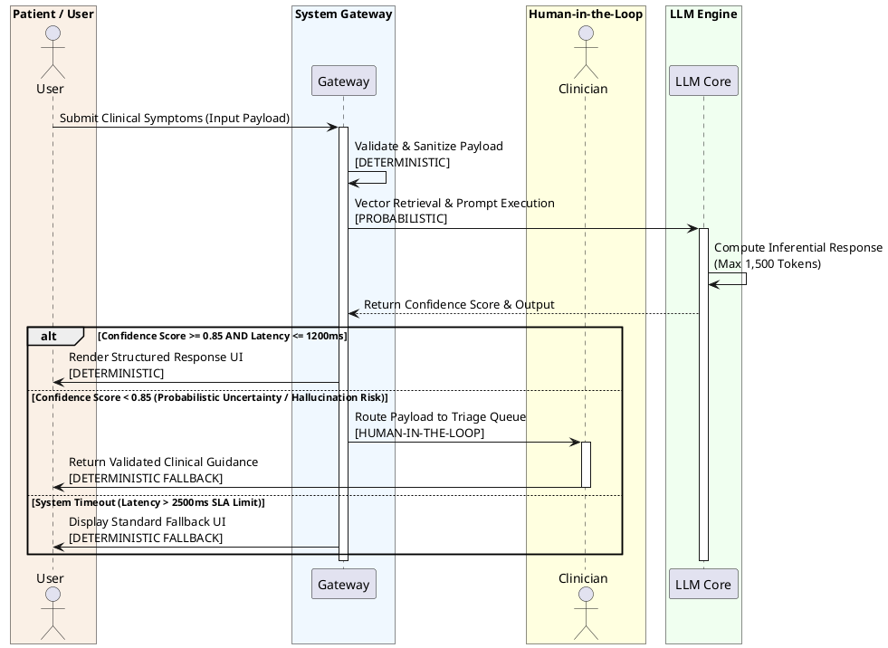

# Class Reflection (Lecture 12): Strategic AI Product Management and System Economics

## 1. Practical Application & Execution

### Context

As a Senior AI Product Manager, my approach to product documentation has changed in a basic way. I used to write passive lists of software features. Now I write risk-managed technical contracts that are binding in legal and financial terms. Traditional Product Requirement Documents (PRDs) often fail for generative AI projects. They treat unpredictable model outputs as if they were predictable software logic. When I treat an AI PRD as a binding technical contract between product management, engineering teams, and enterprise subcontractors, I can set clear financial, speed, and behavior limits from the start. This makes the architecture directly control unit economics, limit the risk of probabilistic behavior, and protect gross margins before any money is spent on engineering.

### Framework 1: Probabilistic Swimlane Workflow Mapping (Diagramming-as-Code)

To keep things clear across complex system boundaries, I require text-based swimlane workflows written with Diagramming-as-Code tools such as PlantUML. When architecture is defined as code, workflow diagrams can be stored in Git next to the project specifications. This gives version-controlled transparency, easy tracking of architecture changes, and automatic auditing by AI tools that check whether the system design is complete.



When using this framework in an AI PRD, system architects must follow these rules:

- **Separate Lanes for Each Actor:** Workflows are split into four clear lanes: Patient/User, System Gateway, Human-in-the-Loop (Clinician/Expert), and LLM Engine.
- **Tag Every Step:** Each step in the workflow is marked as either **[DETERMINISTIC]** (predictable software logic, standard data routing, and state changes) or **[PROBABILISTIC]** (semantic extraction, generated text, and RAG context building).
- **PRD Limits for the LLM Engine:** For every probabilistic step, the PRD must set firm execution limits:
  - **Expected Token Load:** Set upper limits on input context size (for example, a maximum of 4,000 tokens) and on output length (for example, capped at 1,500 tokens).
  - **Latency Limits:** Set strict speed SLAs (for example, a maximum acceptable response time of 1,200 ms) before fallbacks are triggered.
  - **Confidence Thresholds:** Set numeric criteria (for example, a minimum confidence score of 0.85) for allowing automatic output.
  - **UI Fallbacks:** Require clear fallback paths for low confidence or high latency. Examples are showing a structured disclaimer, sending the request to a human clinician in the loop, or using a pre-scripted deterministic user flow.

### Framework 2: Target Costing and the Latency-Cost-Quality Trade-Off Matrix

To bring financial discipline into sprint backlog grooming, I use the Japanese **"Target Costing"** method. The traditional forward-costing approach estimates engineering hours, adds compute costs, and then adds a profit markup. This risks pricing the product above what the market is willing to pay. Target costing works backward from the market. We subtract the target profit margin from the customer's verified Willingness-to-Pay (WTP). This gives the highest cost we can allow to serve one customer:

```
Maximum Allowable Cost-to-Serve = Customer Willingness-to-Pay (WTP) - Target Profit Margin
```

This maximum includes compute costs, API token costs, vector database query costs, and support infrastructure. I build this financial limit directly into technical decision gates before any sprint backlog item is approved:

| Model Choice | Max Token Load | Target Latency SLA | Target Cost Ceiling (USD / Task) | Quality SLA | Fallback Trigger | Approval Criteria at Decision Gate |
|---|---|---|---|---|---|---|
| Frontier Models (e.g., GPT-4o, Claude 3.5 Sonnet) | 8,000 Input / 2,000 Output | ≤ 2,500 ms | $0.045 / task | 99% benchmark accuracy on complex diagnostic reasoning | Latency > 2,500 ms OR Cost > $0.05 | Approved only for high-risk, multi-step reasoning workflows where a failure creates domain liability. |
| Fine-Tuned Small Models (e.g., Llama 3 8B, SLMs) | 2,000 Input / 500 Output | ≤ 400 ms | $0.002 / task | 92% accuracy on narrow domain extraction | Confidence < 0.80 | The required default for repetitive, high-volume semantic parsing where low latency and very low cost matter most. |
| RAG Pipelines (Vector Search + Mid-Tier LLM) | 4,000 Input / 1,000 Output | ≤ 1,200 ms | $0.012 / task | 95% contextual grounding; 0% ungrounded citations | Vector retrieval > 500 ms OR no chunks returned | The standard choice for document-based tasks, balancing token use, fresh context, and output quality. |

Engineering teams must check their token use estimates and system SLAs against this matrix. Any proposed backlog item that goes over the cost ceiling or the latency limit is rejected during sprint refinement.

### The "So What?" Layer

Using both frameworks together reduces two serious failure risks in AI product management:

1. **Removing Contract Ambiguity:** Vague requirements such as "user-friendly interface," "accurate answers," or "reduction in consultation time" often lead to serious disputes with internal engineering teams and third-party vendors. For example, cutting consultation time by half a second technically meets a loose "reduction" requirement but fails commercially. When the PRD uses exact, measurable figures (for example, "minimum 30% reduction in clinician consultation time" or "99% suppression of unsafe or ungrounded outputs"), there are clear benchmarks to verify performance.
2. **Protecting Gross Margin with Architecture Boundaries:** Unwatched LLM API token use and unlimited context windows can quietly destroy product unit economics as adoption grows. To prevent this, product managers must link system boundaries (such as C4 model System Context definitions) directly to financial data. There is a historical parallel. Database architectures in enterprise software limited licensing costs by routing queries through connection pooling modules, or by limiting CPU core deployments (for example, Oracle per-core licensing rules). In the same way, strict C4 system context boundaries limit compute use. Hard limits on context window size and API call frequency, set at the architecture level, keep serving costs below target margins.

### Connection to the Next Section

These internal frameworks build structural and financial controls into product design. But using standard product management models in real enterprise deployments reveals important operating limits.

---

## 2. Limits and Boundaries ("Where it Fails")

### Context

Standard product management theory assumes that operations scale in a straight line, that cost-to-serve curves are predictable, and that business results can be clearly attributed. But in real enterprise environments, textbook frameworks often break down. Reasons include rigid legacy workflows, shifting C4 system context boundaries, and the unpredictable nature of generative AI. Product leaders must test theoretical models against real deployment friction.

### Critical Review: Pure Outcome-Based / Gain-Share Pricing

A widely recommended business strategy in generative AI product management is **Outcome-Based / Gain-Share Pricing**. Under this model, vendors bill clients based on verified financial results (for example, a percentage of confirmed cost savings or extra revenue) and not on inputs such as seat licenses or token use.

```
+-----------------------------------------------------------------------------------+
|               ENTERPRISE SERVICE PRICING SPECTRUM & FRICTION                      |
+-----------------------------------------------------------------------------------+
|  [ Time & Materials (T&M) ]  --> Vendor Low Risk / Customer High Risk             |
|              |                                                                    |
|  [ Fixed-Bid Pricing ]       --> Shared Risk / Bounded Scope Constraints          |
|              v                                                                    |
|  [ Pure Outcome Gain-Share ] --> Vendor Takes Full Operational & Financial Risk   |
+-----------------------------------------------------------------------------------+
| STRUCTURAL FAILURE POINTS:                                                        |
| 1. Attribution Blindness (Inability to isolate AI impact from market variables)   |
| 2. Unbounded Compute Risk (Agentic max_loops failure exhausting API budgets)      |
| 3. Procurement Resistance (Enterprise preference for predictable OpEx billing)    |
| 4. Client Misoperation (User misuse degrading outputs, penalizing vendor revenue) |
+-----------------------------------------------------------------------------------+
```

This reflects the history of enterprise IT services (for example, the contract models studied across Persistent Systems deployments). Corporate clients often push for Time & Materials (T&M) to keep vendors accountable, or demand Gain-Share models to shift delivery risk onto the vendor. Vendors, on the other hand, have historically wanted predictable Fixed-Bid or input-based billing to secure their margins. Applying pure Gain-Share pricing to probabilistic GenAI systems creates serious operational friction.

### Real-World Limits and Failure Modes

Pure outcome-based pricing keeps running into four serious real-world limits:

1. **Attribution Problems and Data Blindness:** It is very hard to separate the exact financial gain from an AI tool from the effects of the wider market, seasonal demand, or older operational changes. Enterprise clients also often refuse to give outside vendors live access to their core financial systems and internal operating data, because of privacy and security concerns. Without open data access, setting baseline metrics and calculating shared gains becomes an ongoing contract dispute.
2. **Unbounded Cost-to-Serve (Agent Retry Loops):** Generative AI platforms have real variable compute costs for every run. In autonomous agent systems, an LLM repeatedly runs tool-use loops to solve a complex task. An agent with no cap on its loop count (max_loops) is a major financial risk. If it enters an endless retry loop without meeting its exit criteria, it can use millions of tokens in minutes. Under a pure gain-share deal, the customer pays nothing if no successful outcome is reached. So the vendor absorbs the whole compute cost, which it cannot recover, and this strains its working capital.
3. **Unpredictable Budgets in Enterprise Procurement:** Enterprise procurement and finance teams work within strict annual OpEx and CapEx budgets. They strongly resist billing that changes with monthly performance or usage spikes. Procurement officers consistently prefer predictable subscriptions or capped usage tiers, and they reject pure gain-share contracts because of budgeting and audit complexity.
4. **User Fatigue and Gaming the System:** The business result of an AI deployment depends heavily on how well end users adopt it and use it correctly. If client employees give poor prompt context, ignore the tool's recommendations, or fail to follow up on AI-generated sales leads, the measured "outcome" falls. Under a pure outcome model, the vendor loses all revenue because of operational failures and user mistakes on the client's side, even though it delivered fully working AI software.

### The "So What?" Layer

Adopting outcome-based pricing from theory, without checking the client's data access, operating setup, and procurement policies, exposes a vendor to high commercial risk. If a vendor pays the variable compute costs while depending completely on the client's adoption to earn revenue, it stops being a scalable software business. It becomes an unpaid risk absorber.

### Connection to the Next Section

Seeing the structural limits of outcome-based pricing pushes product managers to look at hybrid monetization models. These models protect gross margins while speeding up enterprise adoption.

---

## 3. Alternative / Contrarian Perspective

### Context

Good product leadership needs mental flexibility and the willingness to move away from textbook advice when market timing, unit economics, and competition require it. The pure canonical framework says to remove all ambiguity upfront and fully align outcomes before commercial launch. But early-stage generative AI often calls for a more practical go-to-market approach.

### My Argument Against the Canonical View

- **Canonical Premise:** Product managers must resolve all technical ambiguity before launch and must use pricing that is purely aligned with outcomes and value.
- **My Position:** For early V1 releases, AI product managers should use a **Hybrid Usage-Based Model with Pass-Through Compute Surcharges**. This should be combined with **Iterative Ambiguity Resolution in Early V1 Pilots**.

```
+-----------------------------------------------------------------------------------+
|               HYBRID V1 COMMERCIAL & TELEMETRY ARCHITECTURE                       |
+-----------------------------------------------------------------------------------+
| [ Base Platform Fee ]      --> Covers Fixed System Architecture & Core Margins    |
|           +                                                                       |
| [ Pass-Through Surcharges] --> Direct Token Compute Costs Billed to Customer      |
|           +                                                                       |
| [ Bounded Ambiguity V1 ]   --> Captures Real Telemetry to Freeze V2/V3 Parameters |
+-----------------------------------------------------------------------------------+
```

### Market-Based Reasons

Early-stage generative AI products work in very unstable conditions. Foundation model API costs change often, model abilities update fast, and user behavior is not yet well mapped. In these conditions, an early V1 application cannot take on the unit-economics risk of flat-rate or outcome-based pricing without baseline usage data.

A hybrid pricing design gives an immediate financial shield. It combines a predictable base subscription fee with pass-through compute surcharges (or capped usage tiers with overage rates). Passing variable compute costs directly to the customer during V1 pilots protects gross margins against very large context windows, high prompt volumes, and heavy usage.

At the same time, insisting on resolving all technical ambiguity before launching a first version can lead to market failure. Trying to map every edge case, prompt failure, and workflow variation before release delays deployment. To win distribution and build network effects, we need to ship an early V1 that solves the core user problems. We then collect operating data under limited, real-world conditions. Real usage data shows actual token use patterns, system bottlenecks, and rate-limit constraints (such as Requests Per Minute [RPM] and Tokens Per Minute [TPM]). Product teams can then use this to improve prompt designs, fix core workflow boundaries, and build strong V2 and V3 roadmaps.

### The "So What?" Layer

Demanding perfect specifications upfront delays market entry. This gives competitors the chance to win enterprise distribution, build ecosystem lock-in, and collect usage data first. Accepting limited ambiguity in early V1 releases, while protecting margins with pass-through compute surcharges, protects operating margins and speeds up time to market. It also gives the real usage data needed to improve unit economics in future versions.

### Connection to the Next Section

Putting these strategic trade-offs together shows a basic change in how the whole discipline of AI product management should be understood and carried out.

---

## 4. Personal Takeaway & Synthesis

### Core Synthesis

My participation in this session changed my view of AI product management. I used to see it as delivering software features in the traditional way. Now I see it as **Architectural Financial Engineering**. Every architecture choice acts as a direct control knob for product unit economics, gross margin stability, and commercial viability. These choices include how concise the prompts are, how C4 system boundaries are defined, how RAG vector retrieval is set up, and which frontier model is used. Skilled AI product management means continuously balancing probabilistic technical design with disciplined target costing. The goal is to build enterprise products that are predictable, scalable, and commercially durable.
